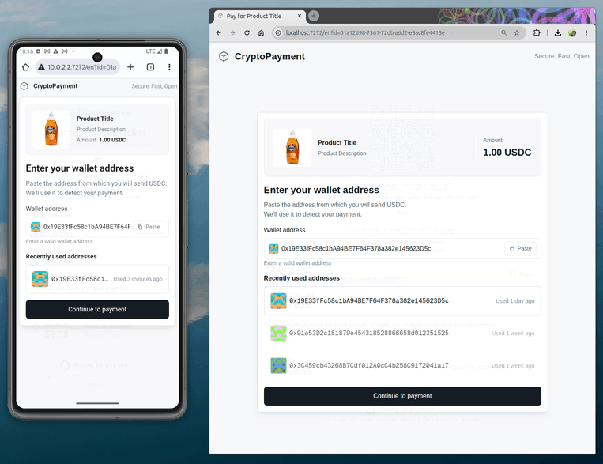
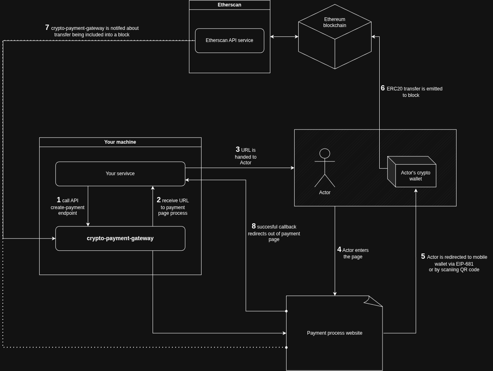

# Crypto Payment Gateway

Self-contained crypto payment gateway for accepting ERC-20 payments (USDC / USDT) on Ethereum. It ships as a single Docker image with the API and web UI, and supports [EIP-681](https://eips.ethereum.org/EIPS/eip-681) for auto-opening mobile wallets and QR codes for quick payment.

Supports **Sepolia** for testing and **mainnet** for production.



### Contents

- [How to start](#how-to-start)
  - [Start service](#start-service)
  - [Create payment](#create-payment)
- [Production setup](#production-setup)
- [API docs](#api-docs)
- [How it works](#how-it-works)
  - [Flow diagram](#flow-diagram)
  - [Payment recognition](#payment-recognition)
- [Mobile wallets on Sepolia](#mobile-wallets-on-sepolia)

## How to start

### Start service

Pull the image from Docker Hub and run it with Docker Compose.

Example `docker-compose.app.yml`:

```yaml
services:
  app:
    image: crypto-payment-gateway:latest
    container_name: crypto-payment-gateway-app
    environment:
      ENV: sepolia
      PHRASE: "material toward work rib online drive pear word still robot kid man phrase here"
      API_KEY: "test"
      ETHERSCAN_API_KEY: "your_etherscan_api_key"
    ports:
      - "7272:80"
    volumes:
      - postgres_data:/var/lib/postgresql/data

volumes:
  postgres_data:
    name: crypto_payment_gateway_pg
```

> [!IMPORTANT]
> Get `ETHERSCAN_API_KEY` from [etherscan.io/myapikey](https://etherscan.io/myapikey). The free tier (100k calls/day) is fair enough.

### Create payment

Create a payment with `POST /api/payment/create`. Authenticate with the `x-api-key` header (same value as `API_KEY` in the compose file).

```bash
curl -X POST http://localhost:7272/api/payment/create \
  -H 'Content-Type: application/json' \
  -H 'x-api-key: test' \
  -d '{
    "amount": "1",
    "paymentToken": "usdc",
    "productTitle": "Product Title",
    "productDescription": "Product Description",
    "productImageUrl": "https://www.ortery.com/wp-content/uploads/2019/05/Dawn-Soap-og01.jpg",
    "callbackUrl": "https://example.com/pay/success"
  }'
```

Example response:

```json
{
  "id": "${uuid}",
  "path": "/en?id=${uuid}"
}
```

The payment process will be available at `http://localhost:7272` + path (e.g. `http://localhost:7272/en?id=...`).

## Production setup

Rules for production:

1. Set `ENV=mainnet`.
2. Use a **new** mnemonic for `PHRASE`. Do not reuse a Sepolia / test phrase — it controls the wallets that receive funds. Treat those wallets as an intermediary only: do not leave all your money there — systematically withdraw profits to a separate, secret cold (or otherwise offline) address.
3. Set a strong random `API_KEY`. The process refuses to start on mainnet without one.

> [!CAUTION]
> Once the database has been initialized with a given `PHRASE`, changing that mnemonic will prevent the container from starting. This guards against a logic error where the database would hold transfer history for different account addresses than the ones derived from the current mnemonic. To run with a new mnemonic, change the Postgres volume name (e.g. `crypto_payment_gateway_pg-2` in the compose file) so Docker creates a fresh database.

## API docs

With `ENV=sepolia`, Swagger UI is available at [http://localhost:7272/api/docs](http://localhost:7272/api/docs). The full API of the service is described there.

## How it works

### Flow diagram

End-to-end payment flow: your service creates a payment, the customer pays from their wallet, and the gateway confirms the ERC-20 transfer via Etherscan before redirecting to your callback.



### Payment recognition

When a new ERC-20 transfer is detected, the gateway links it to a pending payment by matching:

- **Payer address** — the `from` address of the transfer must equal the address the payer gave when creating the payment (the wallet they will send from).
- **Token amount** — the transferred amount (normalized with the token’s decimals) must equal the payment amount.
- **Token contract** — the ERC-20 contract address must match the payment’s token.

Only pending payments that are not yet linked to a transfer are considered. On a match, the payment is marked completed and the UI is notified over WebSocket.

## Mobile wallets on Sepolia

When `ENV=sepolia`, QR codes and “Open wallet app” links use [EIP-681](https://eips.ethereum.org/EIPS/eip-681) payment URIs for the Sepolia test tokens. Many mobile wallets ignore or mishandle these unless you prepare the wallet first:

1. **Enable test networks** — In the wallet settings, turn on Sepolia (or “Show test networks”). Test chains are often hidden by default.
2. **Add the Sepolia ERC-20 tokens** — Import the contract addresses below so the wallet recognizes the token in a scanned QR code or an incoming payment deep link. Without this, the wallet may open with no token selected or reject the URI.

| Token | Sepolia contract                             |
| ----- | -------------------------------------------- |
| USDC  | `0x1c7d4b196cb0c7b01d743fbc6116a902379c7238` |
| USDT  | `0x7169d38820dfd117c3fa1f22a697dba58d90ba06` |
